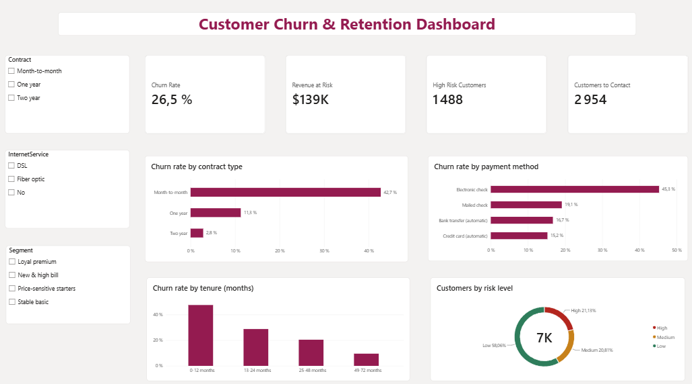
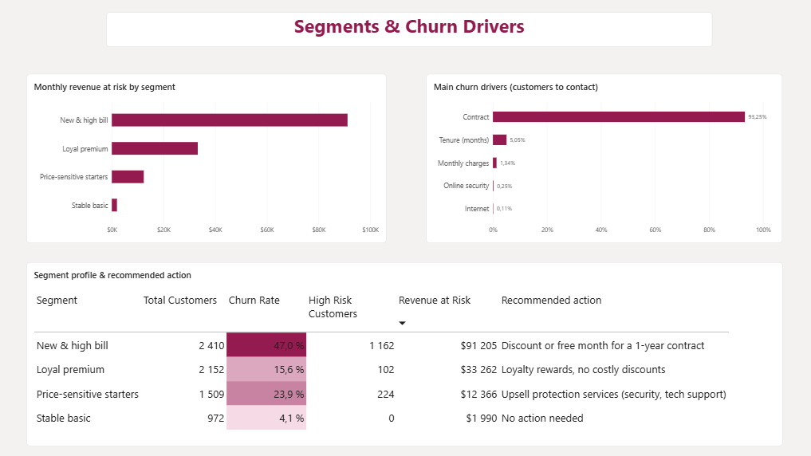
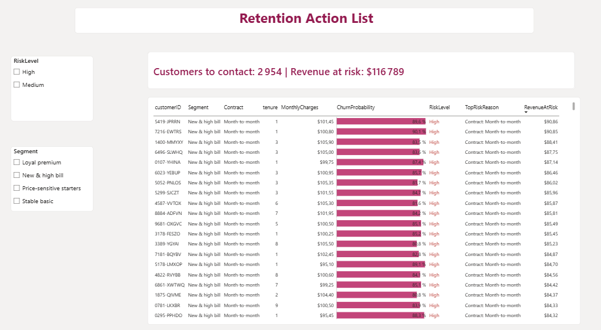
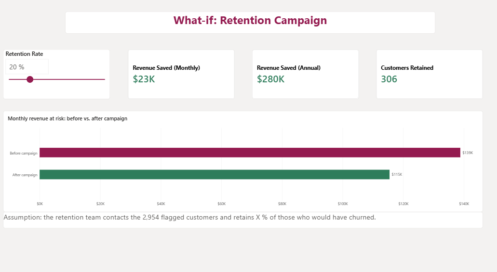

# Customer Churn Prediction & Retention Dashboard

> Predict which telecom customers are likely to leave, explain why, and give the retention team a prioritized action list in Power BI.


**[▶ Live dashboard (Power BI, no account needed)](https://app.powerbi.com/view?r=eyJrIjoiMDUwYzE2ZjYtYzNhNy00NTAxLWJlNjYtYjk2NTQ0OTQzZDRkIiwidCI6ImRiZDY2NjRkLTRlYjktNDZlYi05OWQ4LTVjNDNiYTE1M2M2MSIsImMiOjl9)**



## Business problem

Keeping a customer costs much less than acquiring a new one, yet churn is usually noticed only after it happens.
This project answers three questions a retention manager asks every week:

1. **Who** is likely to leave?
2. **How much revenue** is at risk?
3. **Who should we contact first**, and with which offer?

## Key results

| Metric | Value |
|---|---|
| ROC-AUC (test set) | **0.848** |
| Churners detected (recall) | **81.6%** (305 / 374) |
| Precision of the contact list | **52%** (vs. 26.5% if customers were picked at random) |
| Decision threshold | 0.25 |
| Customers to contact | **2,954** (1,488 high risk + 1,466 medium risk) |
| Monthly revenue at risk (all customers) | **$138.8K**, of which **$116.8K** is covered by the contact list |
| Calibration check | 1,869 expected churners vs. 1,869 actual |
| Campaign value (what-if, 20% retained) | **≈ $23K per month, $280K per year** |

The model was tuned to maximize **precision at 80% recall**: missing a churner (a lost customer) costs far more
than calling a customer who would have stayed (a call or a small discount).

## Main insights

- **Commitment is the strongest signal.** Customers without a long-term contract churn at **42.7%**, versus **11.3%**
  (one year) and **2.8%** (two years). For **93%** of the customers to contact, SHAP identifies the month-to-month
  contract as the #1 risk reason.
- **The first months are critical.** Churn reaches **47%** in the first year and falls to **9.5%** after four years.
  The median tenure of churners is **10 months**, versus **38 months** for active customers.
- **Churners pay more.** Median monthly charge of **$79.65** for churners vs. **$64.43** for active customers.
- **Payment method matters.** Customers paying by electronic check churn at **45.3%**, versus 15 to 19% for the
  other methods.
- **Automatic payment and protection services retain customers.** Churn is **16%** with automatic payment vs. **34.7%**
  without, and drops from **29.8%** (no protection service) to **5.3%** (four protection services).

### Customer segments (K-Means, k = 4)

| Segment | Customers | Avg tenure | Avg monthly | Churn rate | High-risk customers | Monthly revenue at risk | Recommended action |
|---|---|---|---|---|---|---|---|
| **New & high bill** | 2,410 | 15 months | $77 | **47%** | **1,162 (78% of all high-risk)** | **$91.2K** | Discount or free month in exchange for a 1-year contract |
| Price-sensitive starters | 1,509 | 10 months | $29 | 24% | 224 | $12.4K | Upsell protection services (security, tech support) |
| Loyal premium | 2,152 | 57 months | $91 | 16% | 102 | $33.3K | Loyalty rewards, no costly discounts |
| Stable basic | 972 | 54 months | $30 | 4% | 0 | $2.0K | No action needed |

k = 4 was chosen with the elbow method and the best silhouette score (0.425).
"Loyal premium" customers churn less than "Price-sensitive starters" but put **more revenue at risk**, because their
bills are three times higher: they are worth protecting even with a low churn rate.

## Dashboard (Power BI)

**[Open the interactive report](https://app.powerbi.com/view?r=eyJrIjoiMDUwYzE2ZjYtYzNhNy00NTAxLWJlNjYtYjk2NTQ0OTQzZDRkIiwidCI6ImRiZDY2NjRkLTRlYjktNDZlYi05OWQ4LTVjNDNiYTE1M2M2MSIsImMiOjl9)**

| Page | What it answers |
|---|---|
| Executive overview | How big is the problem? Churn rate, monthly revenue at risk, high-risk customers, churn by contract, payment method and tenure, customers by risk level |
| Segments & drivers | Where is the risk and why? Revenue at risk by segment, main churn driver of the customers to contact (SHAP), segment profile with recommended action |
| Action list | Who do we call first? The 2,954 flagged customers sorted by revenue at risk, with probability, risk level and main risk reason |
| What-if | What is a campaign worth? A retention rate slider shows the monthly and annual revenue saved and the customers retained |

| Segments & drivers | Action list | What-if |
|---|---|---|
|  |  |  |

**How it is built**

- **Star schema:** `Customers` fact table (one row per customer) with `Dim Risk`, `Dim Tenure` and `Dim Segment`
  dimensions, which hold the business sort order and the recommended action per segment.
- **DAX measures** in a dedicated `_Measures` table: churn rate, revenue at risk, expected churners, customers to
  contact, dynamic titles, risk colors and the what-if calculations.
- **What-if parameter** (retention rate from 0 to 100%) driving revenue saved and customers retained.
- **Conditional formatting:** churn rate gradient, probability data bars, risk level colors.
- **Power Query:** typed import with English (US) locale and a `RiskDriver` column extracted from the SHAP reason.

Source table: `data/processed/customers_scored.csv` (generated by `src/score.py`).

## Approach

| Step | Notebook / script | What was done |
|---|---|---|
| 1. Exploration | `01_exploration` | Data quality, churn rate by category, numeric distributions |
| 2. Preprocessing | `02_preprocessing`, `src/preprocess.py` | Cleaning (`TotalCharges`), feature engineering, test of extra features |
| 3. Modeling | `03_modeling`, `src/train.py` | Logistic Regression vs. Random Forest vs. XGBoost (5-fold CV), class weights vs. SMOTE, calibration, threshold choice |
| 4. Tuning | `03b_tuning` | Randomized search on 9 XGBoost hyperparameters, optimized for precision at 80% recall |
| 5. Explainability | `04_explainability`, `src/explain.py` | SHAP global drivers and main risk reason per customer |
| 6. Segmentation | `05_segmentation`, `src/segment.py` | K-Means segments, profiling and business actions |
| 7. Scoring | `src/score.py` | One row per customer for Power BI: probability, risk level, segment, reason, revenue at risk |
| 8. Dashboard | `powerbi/` | 4-page Power BI report (see above) |

### Modeling decisions

- **Model choice:** the three models scored within 0.001 ROC-AUC (≈ 0.845 in cross-validation). XGBoost was kept
  for its non-linear effects and fast, exact SHAP explanations.
- **Imbalance (26.5% churn):** class weights and SMOTE gave the same ROC-AUC (0.845). But both **inflate the
  probabilities**: with class weights, the model expected 555 churners on the test set instead of 374. Since the
  dashboard turns probabilities into dollars, the final model is trained **without weights** (well calibrated:
  374.2 expected vs. 374 actual), and recall is recovered by **lowering the decision threshold**.
- **Tuning:** precision at 80% recall went from 51.5% to 52.2% on the test set (ROC-AUC 0.844 → 0.848). The gain is
  smaller than the variation between cross-validation folds (std 0.02), and extra engineered features did not help:
  **performance is limited by the available data rather than by the model**.
- **Risk levels:** High if the churn probability is at least 0.50, Medium between 0.25 and 0.50 (still on the contact
  list), Low below 0.25. Revenue at risk = monthly charge × churn probability.

## Project structure

```
├── data/
│   ├── raw/                 original Kaggle CSV (not versioned)
│   └── processed/           cleaned data + customers_scored.csv (not versioned, regenerated by the scripts)
├── notebooks/               01 exploration → 05 segmentation (with outputs)
├── src/
│   ├── config.py            paths and settings
│   ├── preprocess.py        cleaning and features
│   ├── train.py             final model training
│   ├── explain.py           SHAP helpers
│   ├── segment.py           K-Means helpers
│   └── score.py             scoring table for Power BI
├── models/                  xgb_best_params.json (tuned hyperparameters); trained models are not versioned
├── powerbi/                 Power BI report (churn_dashboard.pbix)
└── reports/
    ├── figures/             charts and dashboard screenshots used in this README
    ├── model_comparison.csv
    └── shap_importance.csv
```

## How to run

```bash
python -m venv .venv
.venv\Scripts\activate             # Windows (macOS/Linux: source .venv/bin/activate)
pip install -r requirements.txt
```

1. Download [Telco Customer Churn](https://www.kaggle.com/datasets/blastchar/telco-customer-churn) and put
   `WA_Fn-UseC_-Telco-Customer-Churn.csv` in `data/raw/`.
2. Run the pipeline:

```bash
python -m src.preprocess     # clean data + features
python -m src.train          # train the final model (uses models/xgb_best_params.json)
```

3. Run notebook `05_segmentation` once (it saves the segmentation), then:

```bash
python -m src.score          # writes data/processed/customers_scored.csv for Power BI
```

4. Open `powerbi/churn_dashboard.pbix` in Power BI Desktop and click **Refresh** (update the CSV path in
   Power Query if your folder is different).

## Limitations and next steps

- **Snapshot data with no dates:** no trend over time; tenure groups are used instead.
- **Limited behavioral information:** no complaints, support calls or usage data. These would be the main lever to
  raise precision above ~52% at 80% recall.
- **Fictional telecom data (IBM sample):** the approach transfers to real CRM data, the figures do not.
- **What-if assumption:** the retention rate is a scenario input, not a measured campaign result.
- Next steps: estimate the cost of a retention offer to choose the threshold by expected profit, schedule monthly
  retraining with new customers, and refresh the dashboard automatically.

## Tech stack

Python · pandas · scikit-learn · XGBoost · imbalanced-learn · SHAP · matplotlib · seaborn · Power BI · DAX · Power Query

---

**Author:** Eya Najlaoui · [LinkedIn](https://www.linkedin.com/in/eya-najlaoui/) · [GitHub](https://github.com/EyaNajlaoui)